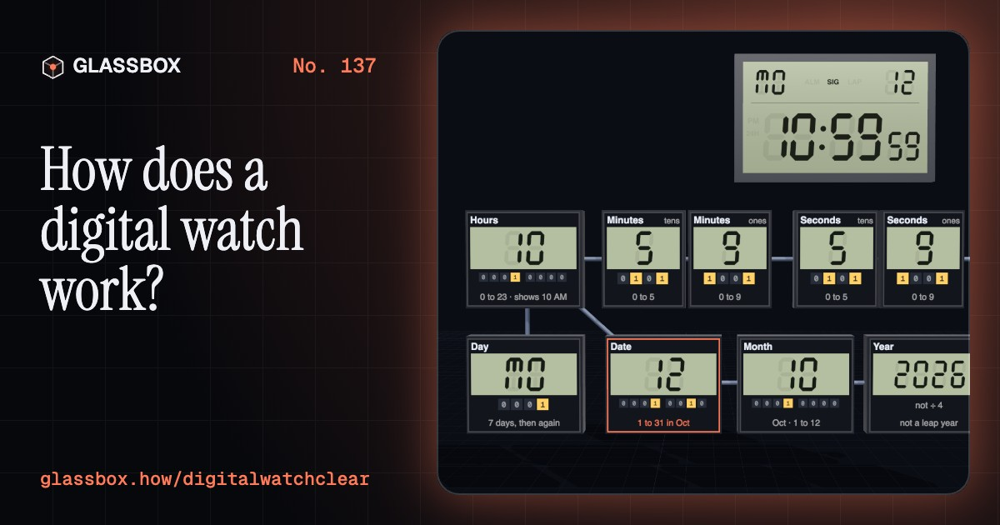
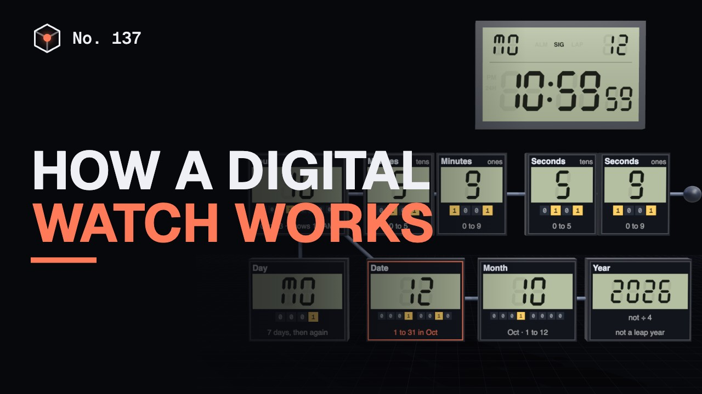
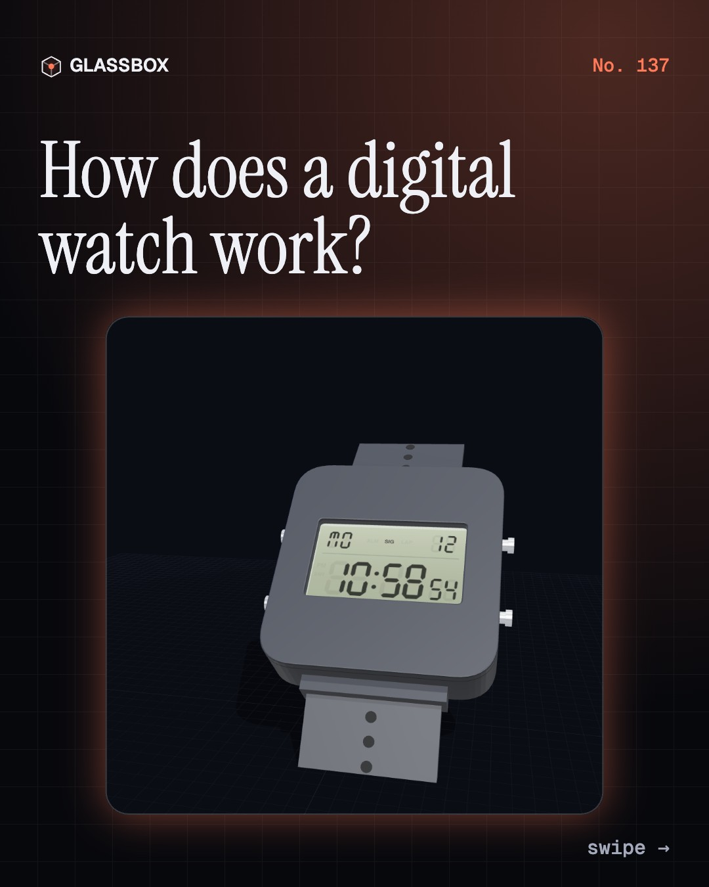
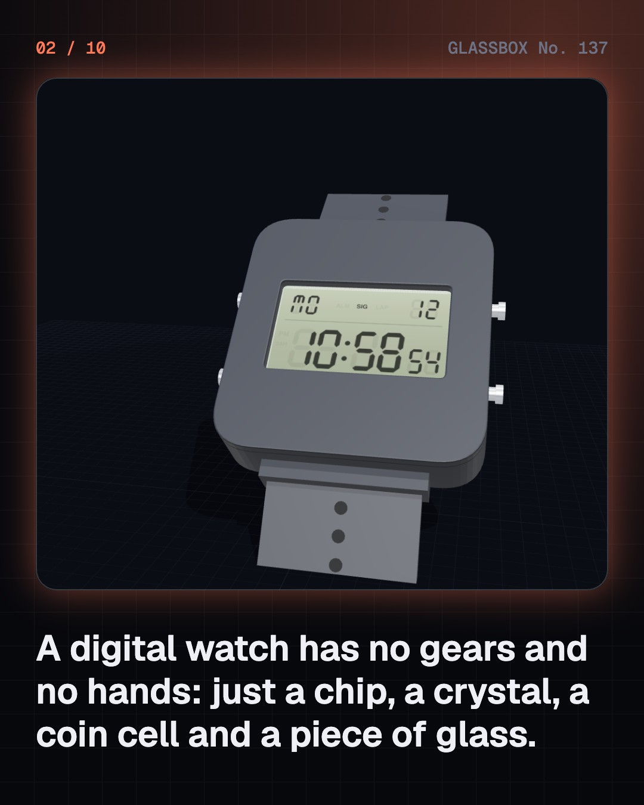
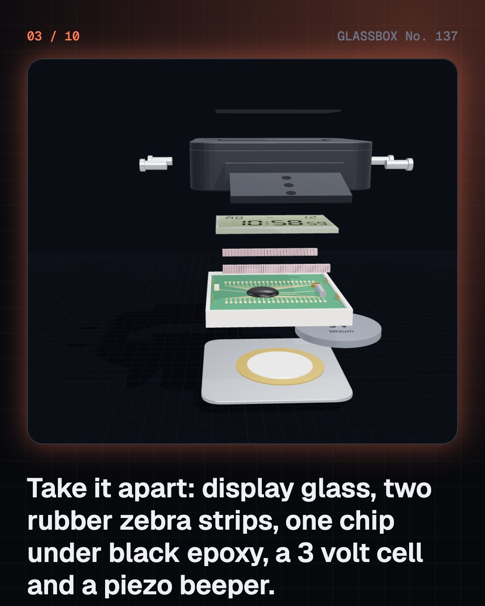
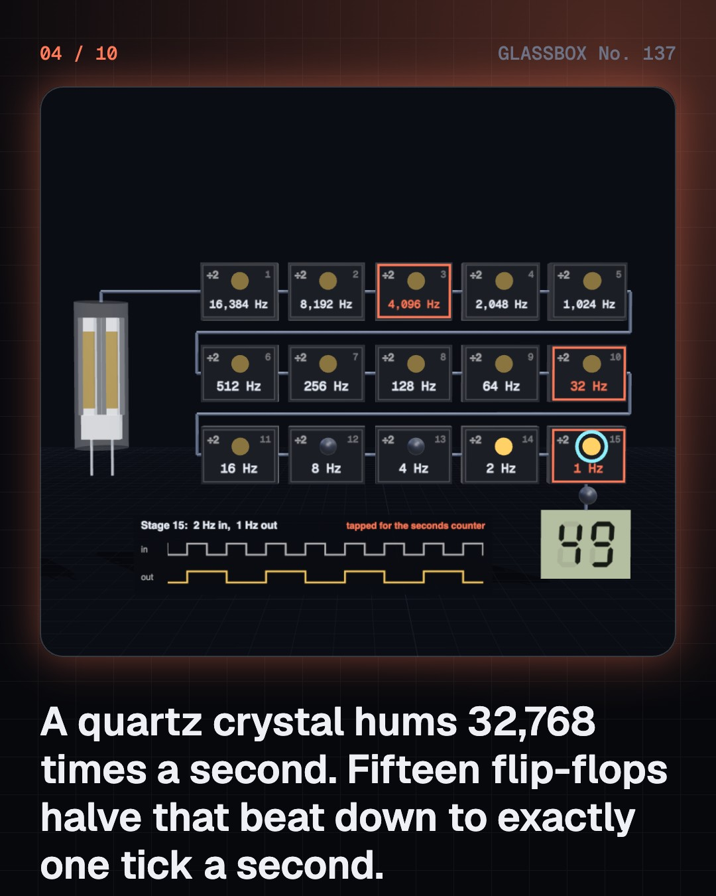

<!-- glassbox:start -->
<!-- Generated from glassbox.json by the Glassbox hub (npm run readme -- digitalwatchclear). Edit glassbox.json, not this block. -->
<p align="center"><a href="https://glassbox.how/e/digitalwatchclear/"></a></p>

<h1 align="center">DigitalWatchClear</h1>

<p align="center"><b>How does a digital watch work?</b><br>No gears, no hands, no ticking. A sliver of quartz, a row of counters and a sandwich of liquid crystal that twists light keep the time on one coin cell for seven years. Take a digital watch apart in 3D and count the seconds yourself.</p>

<p align="center"><a href="https://glassbox.how/digitalwatchclear/"><b>▶ Play with it</b></a> &nbsp;·&nbsp; <a href="https://glassbox.how/e/digitalwatchclear/">Read the 60-second explainer</a> &nbsp;·&nbsp; <a href="https://glassbox.how/digitalwatchclear/glassbox/reel.mp4">Watch the 40-second video</a></p>

<p align="center">
  <a href="https://glassbox.how/e/digitalwatchclear/"></a>
  <a href="https://glassbox.how/e/digitalwatchclear/"></a>
  <a href="LICENSE"></a>
  <a href="LICENSE-CONTENT.md"></a>
  <a href="#privacy"></a>
</p>

## In 60 seconds

1. **A chip, a crystal, a cell and a piece of glass.** Inside the resin case is a small module: a circuit board with one chip under a blob of black epoxy, a quartz crystal in a tiny can, and a 3 volt coin cell. The display glass has no wires. Two rubber zebra strips squeezed between board and glass carry every signal, and a piezo disc on the steel back makes the beep.
2. **One tick a second.** The quartz crystal is cut like a tuning fork and rings 32,768 times a second. That is 2 multiplied by itself 15 times, so a chain of fifteen flip-flops, each halving the beat, ends at exactly one pulse a second. Faster beats along the chain feed the beeper and the display.
3. **A row of counters.** The chip does not know the time. It counts. Seconds run 0 to 59, roll over to 0 and pass a carry to the minutes; minutes carry to hours, hours to the date. The date counter checks the month for its limit, and a watch that stores the year gives February 29 days in a leap year.
4. **Seven bars make every digit.** Each digit is kept as four bits. A decoder turns them into seven on or off signals, one for each bar of the figure of eight. A watch face can have 80 bars, so they share wires: three back electrodes take turns, and 30 chip pins do the work of 81.
5. **A sandwich that twists light.** A segment is liquid crystal between two polarisers set at right angles, over a reflector. With no voltage, the molecules form a quarter-turn twist that guides room light through both polarisers and back out: clear. About 3 volts stands the molecules up, the twist is lost, the light is blocked: dark. It makes no light of its own.
6. **Four jobs on a millionth of an amp.** The Mode button steps the chip from clock to alarm to stopwatch to setting, and the other buttons change meaning in each. An alarm is a comparator and a 4,096 Hz tone into the piezo disc. The whole watch averages about 1.5 microamps, so one coin cell lasts seven years or more. A smartwatch uses over ten thousand times as much.

## Words worth knowing

| Term | Meaning |
|---|---|
| **Quartz crystal** | A tiny tuning fork of quartz that the chip keeps ringing at a very steady 32,768 swings a second. |
| **Divider** | A chain of flip-flops that each halve the frequency; fifteen of them turn 32,768 Hz into one pulse a second. |
| **Counter** | A circuit that adds one for every pulse, rolls over at its limit and sends a carry to the next counter. |
| **BCD** | Binary-coded decimal: each decimal digit stored on its own as four bits, from 0000 to 1001. |
| **Seven-segment display** | A digit drawn with seven bars, named a to g. Different sets of bars make 0 to 9. |
| **Liquid crystal** | A liquid whose rod-shaped molecules share a direction and can be turned by a small voltage. |
| **Twisted nematic** | The LCD type where the molecules make a quarter-turn twist that guides light between two crossed polarisers. |
| **Multiplexing** | Driving many segments with few wires by letting two to four back electrodes take turns, many times a second. |
| **State machine** | A circuit that is always in one of a few modes and steps between them when a button is pressed. |

## A short history

**From a crystal that melted twice in 1888 to a ten-dollar watch that keeps time for seven years on one coin cell.**

- **1888** · A substance with two melting points (Friedrich Reinitzer, Prague (then Austria-Hungary))
- **1968** · RCA shows the liquid crystal display (RCA, New York, USA)
- **1970** · A watch with no moving parts (Hamilton Watch Company and Electro/Data, New York, USA)
- **1970** · The twisted nematic cell (Martin Schadt and Wolfgang Helfrich; James Fergason, Basel, Switzerland and Kent, Ohio, USA)
- **1972** · The Pulsar goes on sale for $2,100 (Hamilton Watch Company, Lancaster, Pennsylvania, USA)
- **1973** · Six digits that never switch off (Seiko (Suwa Seikosha), Suwa, Japan)
- **1974** · A watch that knows the months (Casio, Tokyo, Japan)
- **1976** · The $10 digital watch (Texas Instruments, Dallas, USA)

The full story, with 32 moments, charts, people and 37 sources: [glassbox.how/e/digitalwatchclear/history](https://glassbox.how/e/digitalwatchclear/history/). The data lives in [`history.json`](history.json).

## Video and slides

Made with the Glassbox studio from this box's storyboard (`window.glassbox.director`). Free to reuse under CC BY 4.0.

<a href="https://glassbox.how/digitalwatchclear/glassbox/video.mp4"></a>

<p><a href="glassbox/slide-1.jpg"></a> <a href="glassbox/slide-2.jpg"></a> <a href="glassbox/slide-3.jpg"></a> <a href="glassbox/slide-4.jpg"></a></p>

| File | What | Size |
|---|---|---|
| [`glassbox/reel.mp4`](https://glassbox.how/digitalwatchclear/glassbox/reel.mp4) | Reel / Short, with captions and soundtrack | 1080×1920 |
| [`glassbox/video.mp4`](https://glassbox.how/digitalwatchclear/glassbox/video.mp4) | YouTube video, with captions and soundtrack | 1920×1080 |
| `glassbox/slide-1…10.jpg` | Instagram carousel | 1080×1350 |
| `glassbox/thumb.jpg` | YouTube thumbnail | 1280×720 |
| `glassbox/cover.jpg` | Share card and repo social preview | 1200×630 |
| [`glassbox/history-reel.mp4`](https://glassbox.how/digitalwatchclear/glassbox/history-reel.mp4) | “History in 10 moments” Reel / Short | 1080×1920 |
| `glassbox/history-slide-*.jpg` | History carousel | 1080×1350 |
| `glassbox/post.json` | Post copy and schedule used by the publish kit | |

## Privacy

This box has no accounts and no ads, and it ships its own fonts and libraries. When you run it yourself it sends nothing anywhere. On glassbox.how, the site's `/bar.js` also loads Glassbox's analytics: **Google Analytics** to count visits (it asks first in the EU, UK and Switzerland, and stays off when your browser sends Global Privacy Control or Do Not Track) and **ClickTrust** to detect bots.

It remembers a few things **in your own browser only**, and never sends them anywhere:

| Browser storage key | What it holds |
|---|---|
| `digitalwatchclear.v1` | Which chapters you have opened, your best quiz scores, and sound on or off. |

Exactly what each one sees is at [glassbox.how/privacy](https://glassbox.how/privacy/).

## Licences

- **Code:** [MIT](LICENSE). Use it, change it, ship it.
- **Explanations, text, images and videos** (`glassbox.json`, `glassbox/`): [CC BY 4.0](LICENSE-CONTENT.md). Credit “Glassbox, glassbox.how/e/digitalwatchclear”.
- **Third-party parts** keep their own licences: [three.js](https://threejs.org) (MIT), [Geist, Instrument Serif](https://openfontlicense.org) (SIL OFL 1.1).
- The Glassbox name and logo aren't covered by either licence. See the [terms](https://glassbox.how/terms/).

Found a mistake? [Open an issue](https://github.com/bdeeps/digitalwatchclear/issues). Corrections happen in public.
<!-- glassbox:end -->

## Run it

It's plain HTML, CSS and JavaScript. No build step and no dependencies. Run locally, it contacts no other website.

```bash
python3 -m http.server 8000
```

Three.js and the fonts ship in `vendor/` and `fonts/`, so it also works offline.

Then open http://localhost:8000.

## How it's built

| File | What |
|---|---|
| `index.html`, `css/app.css` | The page and its styles |
| `js/app.js`, `js/stage.js`, `js/ui.js`, `js/kit.js` | The shared Glassbox 3D engine: chapters, 3D stage, controls, quiz, video director |
| `js/chapters/*.js` | One file per chapter: the 3D model, controls, text, key terms, quiz and video scenes |
| `js/dwatch.js` | What the chapters share: the time and date counters, the seven-segment table and watch face, the liquid-crystal and battery sums, and a generic LCD wristwatch in 3D |
| `glassbox.json` | Title, question, explainer beats, key terms, browser storage and credits shown on glassbox.how |
| `reel` in each chapter | The storyboard the Glassbox studio records into short videos |
| `glassbox/` | The published video, slides, thumbnail and post copy |
| `fonts/`, `vendor/three/` | Self-hosted Geist and Instrument Serif (SIL OFL 1.1) and three.js (MIT) |
